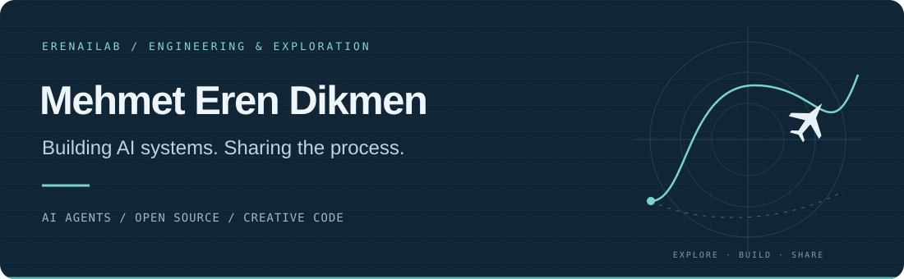

  

  
  
  
  

### Hi, I'm Eren.

I build AI systems, explore how they work, and share what I learn through **[ErenAILab](https://www.youtube.com/@ErenAILab)**. My work connects AI agents, retrieval and automation with practical software — with a soft spot for aviation and interactive worlds.

This is where I share my open-source projects, reproducible experiments and learning notes.

### Selected projects

<table>
<tr>
<td width="50%" valign="top">
<h3>Gökyüzü</h3>

A browser flight simulator over İstanbul and San Francisco. Five aircraft, working cockpits, missions and a leaderboard.

JavaScript · Three.js · WebGL

<a href="https://fs.erenailab.com">Fly now ↗</a> &nbsp; · &nbsp; <a href="https://github.com/erendikmenn/gokyuzu">Explore the code</a>

</td>
<td width="50%" valign="top">
<h3>Jev RAG Benchmark</h3>

Reproducible experiments comparing retrieval and reranking quality, latency and cost on Turkish questions.

Python · RAG · Evaluation

<a href="https://github.com/erendikmenn/jev-rag-benchmark">Explore the benchmark ↗</a>

</td>
</tr>
<tr>
<td width="50%" valign="top">
<h3>Tel</h3>

A chronological news reader bringing together world, finance and AI coverage from selected RSS sources.

TypeScript · Next.js · RSS

<a href="https://github.com/erendikmenn/tel">Explore the project ↗</a>

</td>
<td width="50%" valign="top">
<h3>Tripo Cozy World</h3>

A small, explorable 3D world built from image-generated models. The code, assets and creation guide accompany an ErenAILab video.

TypeScript · Three.js · Image-to-3D

<a href="https://github.com/erendikmenn/erenailab-tripo-cozy-world">Explore the world ↗</a>

</td>
</tr>
</table>

**More experiments:** [Jev LLM Router Benchmark](https://github.com/erendikmenn/jev-llm-router-benchmark) · [İZ — a cinematic watch experience](https://github.com/erendikmenn/erenailab-tripo-watch-scroll)

### What I'm interested in

- **AI agents & automation** — connecting models, tools and useful workflows.
- **RAG & evaluation** — understanding the trade-offs between quality, latency and cost.
- **Engineering & simulation** — industrial AI, electronics and interactive flight experiences.
- **Learning in public** — documenting experiments and making technical ideas easier to explore.

**Tools I work with**  
`Python` · `TypeScript` · `Next.js` · `FastAPI` · `Docker` · `PostgreSQL` · `n8n` · `AWS` · `Three.js`

### Beyond the repositories

**[YouTube / ErenAILab ↗](https://www.youtube.com/@ErenAILab)** — AI walkthroughs, practical experiments and technical explainers.  
**[X / @ErenAILab ↗](https://x.com/erenailab)** — AI research, tools and notes along the way.

<strong>Türkçe · Kısaca ben</strong>

Merhaba, ben Mehmet Eren Dikmen. Yapay zekâ sistemleri geliştiriyor; AI ajanları, RAG ve otomasyon üzerine çalışıyorum. Havacılık, elektronik ve simülasyon da ilgi alanlarım arasında.

ErenAILab'da denediğim araçları, öğrendiklerimi ve geliştirdiğim projeleri paylaşıyorum. Bu profilde açık kaynak çalışmalarımı, deneylerimi ve öğrenme notlarımı bulabilirsin.

---

<a href="https://mehmeterendikmen.com/en">More about my work</a> &nbsp; · &nbsp; <a href="https://www.linkedin.com/in/mehmet-eren-dikmen">Let's connect</a>

